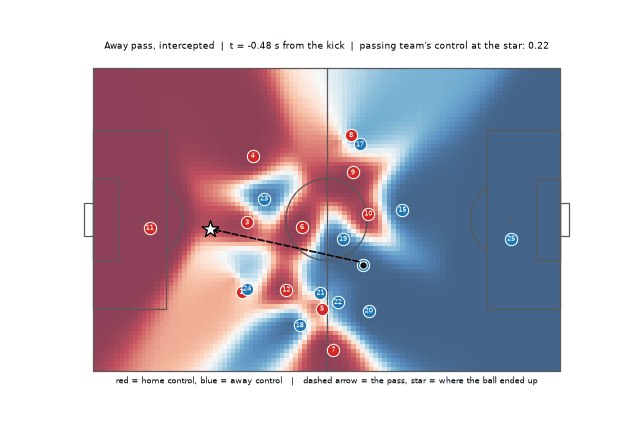
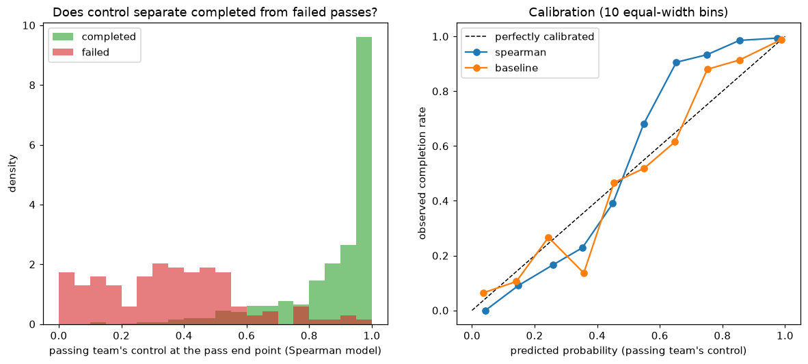
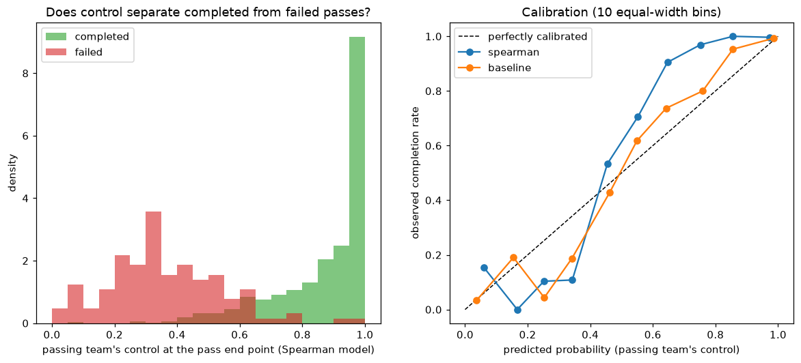
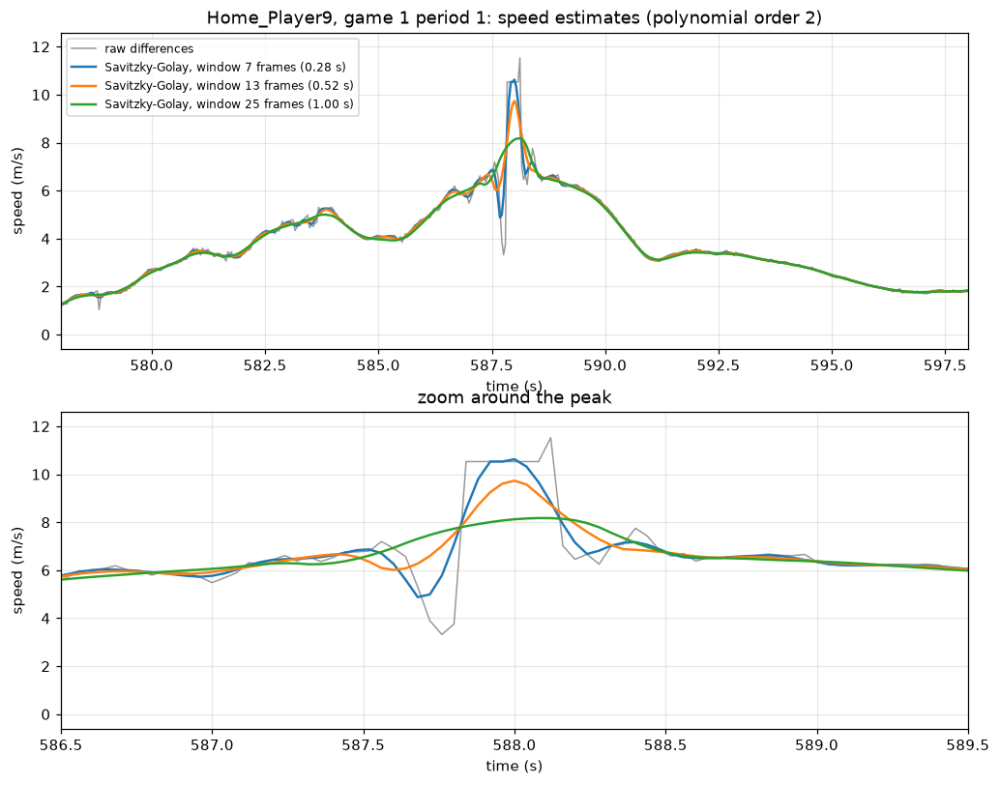

# Pitch control from football tracking data

Which parts of the pitch does each team control, and does that tell us which passes succeed?
This project builds the **Spearman (2018) pitch control model** from scratch on open tracking
data, then tests it against about **2,000 real passes** from two matches, with a simple
baseline for comparison and an honest account of what the test can and cannot show.



*An away team pass that was intercepted. Red = home control, blue = away control, white star =
where the ball ended up. The read-out is the passing team's control at the star if the ball
were still in flight at that moment.*

## Results

Same fixed parameters on both games, nothing tuned. Score for each pass = the passing team's
control share at the pass end point, measured at the moment the pass is hit, using the pass's
real flight time. Completed open-play passes against interception losses. 95% bootstrap intervals.

| Game | Passes (completed / failed) | Model | AUC | Brier score |
|---|---|---|---|---|
| 1 | 781 / 138 | Spearman | 0.961 [0.940, 0.977] | 0.059 [0.052, 0.067] |
| 1 | | Baseline | 0.962 [0.942, 0.977] | 0.047 [0.038, 0.056] |
| 2 | 952 / 129 | Spearman | 0.970 [0.956, 0.983] | 0.055 [0.049, 0.061] |
| 2 | | Baseline | 0.966 [0.949, 0.980] | 0.040 [0.033, 0.048] |

(Brier of always predicting the completion rate: 0.128 in game 1, 0.105 in game 2.)




**What this shows**

- Control at the pass end point separates completed from failed passes very well, and the result
  replicates on a second, independent game.
- **The full Spearman model does not beat a simple logistic baseline.** Their AUCs are equal and
  the baseline has the better Brier score. Both are under-confident above 0.5, which makes
  sense: passers aim at space their team already controls, so a control share is not a
  completion probability.
- The published parameters (5 m/s, 0.7 s) came out best in a sensitivity grid in both games, at
  the edge of the grid, so the optimum is not bracketed. I did not tune them.
- Using only information from before the kick (state taken 6 frames earlier) barely changes
  anything: AUC 0.954 against 0.961 in game 1.

## How it works

1. **Coordinates:** Metrica's 0-1 values become metres on a 105 x 68 m pitch, origin at the
   centre, y pointing up. The halves to rotate are detected from the home goalkeeper's side,
   because the two games are mirrored.
2. **Velocities:** implausible steps (above 12 m/s) are dropped, short gaps are interpolated
   only when the bridge is physically plausible, then a Savitzky-Golay filter (13 frames,
   order 2) gives velocity.
   
3. **Time to intercept:** each player keeps their velocity for a 0.7 s reaction time, then runs
   straight to the point at 5 m/s.
4. **Control:** players gain control of a point at a rate that grows as their arrival becomes
   likely; the uncontrolled share decays exponentially. A plain Euler step overshot with 22
   players, so the integration uses the exact exponential step instead.
5. **Validation:** AUC, Brier score and calibration with bootstrap intervals, against a
   logistic baseline whose only parameter is tied to the model's own timing uncertainty.

Every modelling choice, the alternatives I considered and why I chose as I did are in
[docs/modelling_decisions.md](docs/modelling_decisions.md). The parameter values match the
public tutorial implementation of the model (see References); the one deviation is a single
control rate for all players and the real pass flight time instead of an assumed ball speed.

## Limitations

- **The test is partly circular.** A pass's end point is where the ball ended up, so it partly
  reveals the outcome; for failed passes it is where the opponent took the ball, not the
  intended target, which the data does not record. The AUC is therefore optimistic: use it to
  compare models and settings, not as an absolute claim about prediction.
- About 130 failed passes per game, so intervals are fairly wide. Two games only; the third
  Metrica game (different file format) is not used.
- One top speed and one control rate for every player, goalkeepers included, and no
  acceleration limit. The observed 99th-percentile speeds (5-7 m/s) are above the 5 m/s used.
- Tracking glitches below the 12 m/s cut-off (a position that holds, then catches up) are
  damped but not removed.

## Reproduce

Python 3.14 was used.

```bash
python -m venv .venv && source .venv/bin/activate
pip install -r requirements.txt
bash scripts/download_data.sh          # Metrica games 1 and 2 into data/raw/ (git-ignored)
pytest -q                              # 39 tests
python scripts/validate.py data/raw/game1   # also game2; prints the tables above
python scripts/make_clip.py                 # the clip above
```

Other scripts: `plot_frame.py` (orientation check), `plot_smoothing.py` (window comparison),
`plot_sensitivity.py` (control surfaces under varied parameters).

## Layout

```
src/pitchcontrol/   coords, io_metrica, kinematics, intercept, control, surface, validation, pitch
tests/              one test file per module
scripts/            validation, figures, clip, data download
docs/               modelling_decisions.md and the images above
```

## Data and credits

Tracking and event data: [Metrica Sports sample data](https://github.com/metrica-sports/sample-data)
(anonymised players and teams), used as Metrica asks: responsibly, with the source acknowledged.
The raw data is not in this repository; the figures and clip are derived visualisations of it.

## References

- W. Spearman, *Beyond Expected Goals*, MIT Sloan Sports Analytics Conference, 2018 (pitch control).
- L. Shaw, [LaurieOnTracking](https://github.com/Friends-of-Tracking-Data-FoTD/LaurieOnTracking),
  Friends of Tracking: the public tutorial implementation whose default parameters I used.
